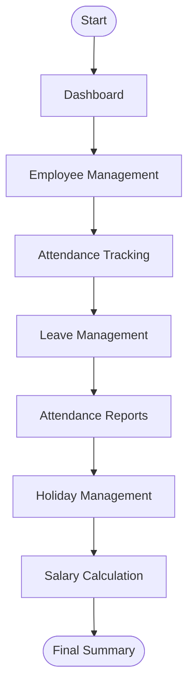
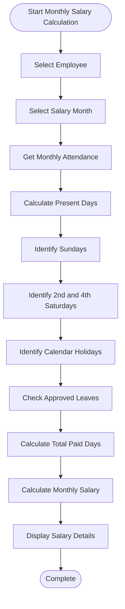
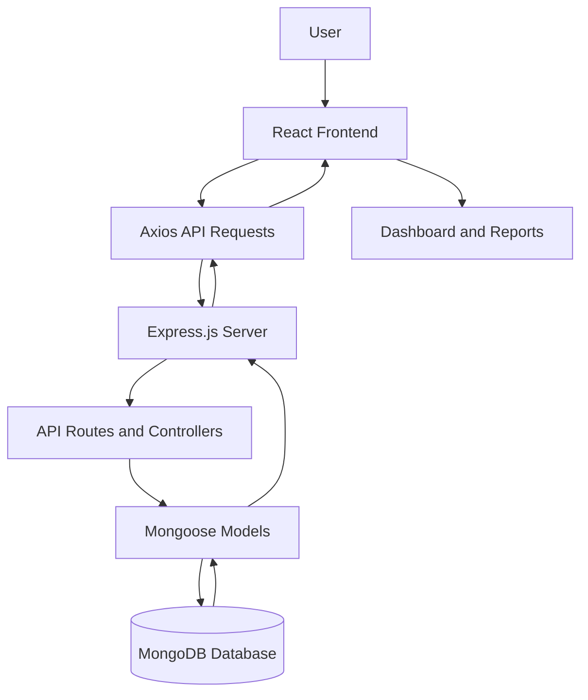

# 🕒 Attendance Management System

## 📌 Overview

**Attendance Management System** is a full-stack web application built using the **MERN Stack (MongoDB, Express.js, React.js, and Node.js)** to simplify employee attendance tracking, leave management, and salary calculations.

The application provides a centralized platform where organizations can manage employee records, monitor daily attendance, process leave requests, and generate attendance-based salary information.

It aims to reduce manual attendance work, improve record accuracy, and make employee management more efficient.


## ✨ Key Features

### 👥 Employee Management
- Maintain employee information and records.
- Organize employee details in one place.
- Access employee-related attendance information.

### 🕒 Attendance Management
- Record employee check-in and check-out times.
- Track daily attendance status.
- Monitor employee presence and working days.

### 📝 Leave Management
- Submit and manage employee leave requests.
- Review and approve or reject leave applications.
- Track approved leave records.

### 💰 Salary Calculation
- Calculate monthly salary based on attendance and paid days.
- Consider weekly holidays and applicable calendar holidays.
- Include Sundays and 2nd & 4th Saturdays in paid-day calculations.
- Account for approved leaves according to salary rules.

### 📊 Dashboard & Reports
- View employee and attendance information.
- Monitor attendance records.
- Access important workforce information.

### 📅 Holiday Management
- All Sundays.
- 2nd and 4th Saturdays.
- Applicable calendar holidays.

### 📱 User Interface
- Clean and organized interface.
- Responsive layout.
- Easy navigation between application modules.

---
## 🔄 Application Workflow

The application follows a simple process to manage employee records, attendance, leave requests, and salary calculations.



### Workflow Overview

- **Dashboard:** View employee and attendance information.
- **Employee Management:** Manage employee records.
- **Attendance Tracking:** Record check-in and check-out.
- **Leave Management:** Approve or reject leave requests.
- **Attendance Reports:** Review monthly attendance.
- **Holiday Management:** Consider Sundays, 2nd and 4th Saturdays, and applicable holidays.
- **Salary Calculation:** Calculate monthly salary based on paid days.

**Outcome:** Simplified employee attendance and payroll management.
## 💰 Salary Calculation Workflow

The salary module considers attendance, weekly holidays, applicable calendar holidays, and approved leaves to determine monthly paid days.



*Note: The final salary depends on the organization's payroll policy and applicable leave and holiday rules.*

---

## 🛠️ Technology Stack

| Technology | Purpose |
|---|---|
| React.js | Frontend development |
| Tailwind CSS | UI styling |
| JavaScript | Application logic |
| Node.js | Backend runtime |
| Express.js | REST API development |
| MongoDB | Database |
| Mongoose | Database modeling |
| Axios | API communication |
| React Router | Frontend navigation |
| Lucide React | Icons |
| Vite | Frontend build tool |

## 🏗️ Project Architecture

The application follows a frontend-backend architecture.



## 📁 Project Structure

```text
attendance-management/
│
├── frontend/
│   ├── public/
│   ├── src/
│   ├── package.json
│   └── vite.config.js
│
├── backend/
│   ├── index.js
│   ├── package.json
│   └── .env
│
├── jsconfig.json
└── README.md
```
## 🚀 Future Enhancements

The following features can be introduced in future versions:

- [ ] Role-based authentication (Admin and Employee).
- [ ] Employee self-service dashboard.
- [ ] Monthly attendance export to Excel and PDF.
- [ ] Advanced attendance analytics.
- [ ] Automated salary slips.
- [ ] Leave approval notifications.
- [ ] Email notifications.
- [ ] Cloud deployment.
- [ ] Improved reporting and payroll management.

---
<p align="center">
  <b>A Full-Stack MERN Application for Smart Employee Attendance & Workforce Management</b>
</p>


<p align="center">
  
  
  
  
</p>

<p align="center">
  <a href="https://github.com/Sweety-2024/attendance-management">GitHub Repository</a> •
  <a href="https://www.linkedin.com/in/sweety-kumari-46217034b/">LinkedIn Profile</a>
</p>

---


## 👩‍💻 Developer

**Sweety Kumari**

Aspiring Full-Stack Developer | MERN Stack | Data Analytics

- **GitHub:** [Sweety-2024](https://github.com/Sweety-2024)
- **LinkedIn:** [Sweety Kumari](https://www.linkedin.com/in/sweety-kumari-46217034b/)
- **Project Repository:** [Attendance Management System](https://github.com/Sweety-2024/attendance-management)

---

## ⭐ Support

If you find this project useful or interesting, consider giving this repository a ⭐ on GitHub.

**Built with ❤️ by Sweety Kumari**
